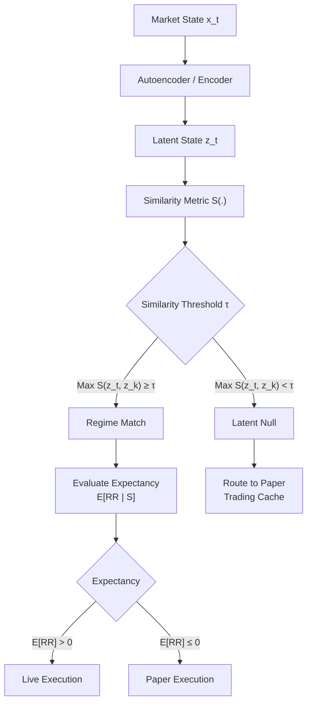

# Autoencoded Regime Routing: Unsupervised State Detection and Out-of-Distribution Caching in Algorithmic Execution using Mixture of Experts
> ### Research Hypotheses
>
> **H1 — Market Recurrence**  
> Previously observed latent market states recur over time with sufficiently high similarity to remain relevant. States that become stale, rarely recur, or consistently exhibit low similarity should lose relevance and eventually be removed from the active regime cache.
>
> **H2 — Latent Regime Persistence**  
> Once a latent market state is identified, it persists for a sufficient duration to provide a meaningful execution horizon. This can be evaluated through regime autocorrelation, state-transition probabilities, and episode duration.
>
> **H3 — Predictable Expert Specialization**  
> Conditional on a sufficiently similar latent state, the historically associated expert retains predictable out-of-sample performance. Similarity to a latent state should therefore provide information about which specialized expert is likely to perform well.

Explanatory Data Analysis (EDA): -  
Historical Walkforward with Purged Chronological Walkforwards and Monte Carlo: -  

## 1. System Architecture
The proposed system addresses the fundamental challenge of financial market non-stationarity - when data distribution shifts degrade static model performance - by decoupling regime recognition and trade execution. The framework consists of two-layer hierarchical architecture.
### 1.1 Layer 1: Latent Regime Detection & Memory Caching 
An unsupervised representation learner (e.g. autoencoder, Hidden Semi-Markov Model, VQ-VAE, etc) compresses high dimensional market features $x_t \in \mathbb{R}^d$ into a lower dimensional latent embedding $z_t \in \mathcal{Z}$. The system maintains a dynamic cache $C_t$ of verified latent state centroids $\{\bar{z}_1, \bar{z}_2, \dots, \bar{z}_k\}$.
### 1.2 Layer 2: Expectancy-weighted Mixture of Experts (MoE)
A set of specialized execution models $\{M_1, M_2, \dots, M_K\}$ mapped to cached latent states. Model routing is governed by an Expectancy Function $E[RR \mid S]$, which estimates the risk-reward ratio and win rate as a function of the similarity score $S(z_t, \bar{z}_k)$ between the current state $z_t$ and the historical cluster $\bar{z}_k$.
### Latent Null / Abstention Mechanism
To prevent novel market states from being forcibly assigned to an existing regime, the system maintains a **Latent Null** state for observations with insufficient similarity to any verified regime.

Define:

$$
S_t^* = \max_{k \in C_t} S(z_t, \bar{z}_k)
$$

If

$$
S_t^* < \tau
$$

the observation is classified as **Latent Null** and routed to a separate cache rather than a live expert.

Novel observations are accumulated until sufficient evidence exists to determine whether they form a recurring and profitable regime. A candidate state may be promoted to the verified regime cache when it satisfies predefined requirements such as minimum sample size and positive lower-confidence-bound expectancy.

$$
\text{Novel State}
\rightarrow
\text{Latent Null}
\rightarrow
\text{Evidence Accumulation}
\rightarrow
\text{Validation}
\rightarrow
\text{Verified Regime}
$$

Until validation, associated trades remain paper trades. This allows the system to discover new regimes without immediately exposing live capital to unvalidated states.

## 2. Methodology & Mathematical Formulation
### 2.1 Latent Space Encoding & Similarity Score
*Take current market condition, compress them into smaller numerical representations, compare the representation to previously seen latents*  

Let $x_t \in \mathbb{R}^d$ represent the market feature vector at time step $t$ (e.g., microstructural volatility, order book imbalance, normalized volume). An encoder $f_\theta: \mathbb{R}^d \to \mathcal{Z}$ maps $x_t$ to a continuous latent representation $z_t = f_\theta(x_t)$.  
The similarity score $S(z_t, \bar{z}_k) \in [0, 1]$ between $z_t$ and a cached regime centroid $\bar{z}_k$ is computed via cosine similarity:$$S(z_t, \bar{z}_k) = \frac{z_t \cdot \bar{z}_k}{\Vert{}z_t\Vert{}_2 \Vert{}\bar{z}_k\Vert{}_2}$$

### 2.2 Expectancy-Weighted Gating (Layer 2)
*Among the models whose historical market conditions look similar to the current market, choose the one whose historical performance is strongest after penalizing unreliable estimates.*

Let $RR$ denote the trade risk-reward outcome. For each expert $M_k$, historical trades are binned by similarity thresholds $\mathcal{B} = \{[0.5, 0.6), [0.6, 0.7), \dots, [0.9, 1.0]\}$.The empirical expected return $\hat{\mu}_k(S)$ for expert $M_k$ given similarity $S$ is computed using the Lower Confidence Bound (LCB) to account for sample size variance:$$\hat{\mu}_k(S) = \bar{RR}_k(S) - c \cdot \frac{\sigma_k(S)}{\sqrt{n_k(S)}}$$

Where:
- $\bar{RR}_k(S)$ is the mean risk-reward ratio in similarity bin $S$.
- $\sigma_k(S)$ is the sample standard deviation.
- $n_k(S)$ is the number of historical trades executed in that similarity bin.
- $c$ is a hyperparameter tuning the statistical significance bound (e.g., $c = 1.96$ for a $95\%$ confidence level).

The active expert $M^*$ is selected via:$$M^* = \arg\max_{k \in \{1, \dots, \vert{}C_t\vert{}\}} \hat{\mu}_k(S(z_t, \bar{z}_k))$$

## AI Prompt
is this a good idea?

there are 2 layers. the main executor (strategy) and the regime detection layer. however the regime detection isnt just enable/disable. this is how it works

it is a regime-dependent MoE system. The market is non-stationary as in the rules are always changing but the market is somewhat repeating. am i correct?

so the regime-dependent MoE system is a unsupervised learner that identifies something known as latent states representing different types of market regimes. Since an unsupervised learner is very good in detecting micro changes, we can use that to activate certain ml models.

for example we have the model's txt from 2024, 2025 to 2026. so the current session market follows the latent state of 2024 where the similarity score > 60% or 70%. based on edge expectancy charted by similarity score we can probably extrapolate this

50-60%: +0.15rr per trade
60-70%: +0.19rr per trade
70-80%: +0.20rr per trade
80-90%: +0.20rr per trade
90-100%: +0.20rr per trade

latent of 2024 hence returns roughly 0.19rr per trade

But the model of 2025 returns a similarity score of 90%

50-60%: +0.10rr per trade
60-70%: +0.14rr per trade
70-80%: +0.22rr per trade
80-90%: +0.30rr per trade

based on this we use model of 2025 because 0.30rr per trade > 0.19rr per trade.

However in real execution there are probably thousands of latent states at once so theres a lot of ml models. to limit computational problems we'll keep it at a max limit. if it exceeds the latent states we'll delete the ones that are in the least use

In real execution we'd probably pick the top 5 models. if for example right now the market shares very high similarity with latent 1, then the trades that happens here or the price data will be recorded and placed into latent 1 for further improvements of the ml model.. another very important thing is theres always a latent null. latent null refers to a latent state that is unrecorded previously in the list. so there would be another cache to store latent states. maybe 1000 trades or whatever before its finally verified as an official latent state

this does solve overfitting for the main strategy but delegates the problem to the regime detector instead. second, if the latent states arent strongly positive autocorrelated, itll suffer problems just like any other indicators (like for example rsi 50 strategy on ma 200. 50 isnt a hard line. sometimes its 40, etc making it hard to interpret if its a fakeout or not)

but this does ensure that you trade only in regimes that you know and you stop trading in regimes you dont know yet (you transmit to paper trades to record the data, so until its trained and its backtested edge returns, only then u can run it).

so our unsupervised learner needs to become incredibly smart in identifying similarity scores. 