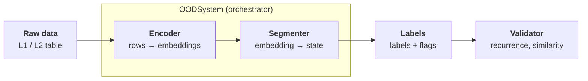

# A Computational Framework for Adaptive OOD Identification with Open-Set Temporal Representation Learning in QTS
OSADP-Core Version  : v1.0.0  
Author              : Himaska Lin  
version             : v1.0.0

# 1.0 Structural and Variable Design

## 1.0A Defining Roles
**Segregation roles**
|File|Role|
|:--|:--|
|ood.py|OOD system manager that calls processes in order and attach final flags|
|base_regime_encoder.py|Turns window of recent rows into fixed length of numbers (embedding)|
|base_regime_segmenter.py|Takes embeddings and decides states|
|regime_validator.py|Measure/validation framework to test its effectiveness|

**Important notation and default numbers** 
|Symbol|Meaning|Default|
|:--|:--|:--|
|T| rows in the raw table (steps in data stream) | -
|N| primitives built from the raw columns | $\approx$ 4 for L1, 15 or more for L2|
|W| Window length (sequence_window), short term memory horizon for local shape/movement | 32 |
|B| Bins per window (embedding_bins), splitting window length to chronological chunks, averaging and capturing trajectory | 8 (each bin is 4 rows) |
|D| Embedding length = (B+3) * N, the size of single row's embedding or fingerprint | 44 for N=4, 165 for N=15, 495 for N=45|
|K| Hard limit on max number of permanent, active regime states the system can learn. Prevents overfitting to hyper-specific states. | At most 10 (max_states) |
|C| Maxmimum of candidate clusters stored in memory while waiting for new pattern to recur | 128 |
|E| Number of unbroken episodes of specific regime label over time (recurrence) | Data dependent |

## 1.0B Minor Default Variables

### Normalization & Context

* **Normalization Window (500 rows, min 50):** Rolling mean/std baseline for Z-scoring; uses `shift(1)` to exclude current row $t$ for zero lookahead bias.
* **Z-score Clip (±8.0):** Hard-caps normalized primitives between -8.0 and +8.0 to prevent flash spikes from dominating RMS distance.
* **Slow Window (5000 rows, min 50, weight 1.0):** Long-horizon rolling baseline (volatility for returns, mean for levels) Z-scored against expanding history to preserve macro regime context.

### Clustering & Distance Thresholds

* **`match_threshold` (1.5):** Scaled RMS distance cutoff; ≤ 1.5 assigns row to a known state, > 1.5 routes row to the candidate pool.
* **`novel_threshold` / `candidate_threshold` (0.25):** Unscaled Euclidean distance cutoff; ≤ 0.25 joins an existing candidate cluster, > 0.25 creates a new candidate cluster.

### Recurrence & Promotion Rules

* **Promotion Criteria (200 obs & 3 episodes):** Candidate cluster must accumulate ≥ 200 rows across ≥ 3 distinct visits before becoming a permanent state.
* **`candidate_episode_gap` (32 rows):** Minimum row gap between candidate visits to increment episode count; matched to $W = 32$ so overlapping trailing windows aren't double-counted.

### Smoothing, Safety & Expiry Controls

* **`min_dwell` (5 rows):** Hysteresis debounce filter; a new label must persist for 5 consecutive rows before `latent_id` updates, trading 4 rows of latency for zero signal flicker.
* **`mature_state_observations` (200 rows):** Additional matched rows required after state promotion before `state_mature = True` and trading is permitted.
* **State Expiry (100,000 rows):** Prunes an established state prototype if it goes 100,000 consecutive rows without a match.
* **Candidate Expiry (5,000 rows):** Deletes an unpromoted candidate cluster if it goes 5,000 consecutive rows without a match.

# 1.1 System Design
## PART A: Initiator Strategy()
Initiator --> Files call using run_ood(df, cfg) for example in strategy().

**What it does**. The OOD stage is step 2 of 7. It receives df, the raw table, and not feat_df, the output of compute_features. run_ood builds OODSystem(**cfg["ood"]) and calls .detect(raw, process_from). The result, regimes, is later aligned to the feature index by align_regimes_to_index and used by the GP, the metalabel model and the barrier events.

**Why**. Feeding OOD only the raw stream means engineered features, forward returns and targets cannot leak into regime discovery. Unknown keys under ood: raise a TypeError (see segment 2), so a typo in settings.yaml fails loudly.

**Performance** O(1) time. Memory is negligible as it is a glue code.

## Part B: OOD Manager
Initiator --> run_ood() calls to `OODSystem.__init__` to contact it.
**What it does**. It builds the encoder and the segmenter from the settings and applies defaults for any value left as None:
- slow_feature_window=5000
- slow_min_periods=50
- slow_level_weight=1.0
- max_novel_clusters=128
- candidate_expiry=5000
- centroid_update_rate=0.0
- min_state_scale=0.1
- state_expiry_observations=100000
- learn_novel=True

The setting names are renamed on the way into the segmenter. It acts as a guard against unsupported keywords and candidate_episode_gap >= encoder window.

**Why**. The gap guard is the one rationale the code states: it exists "to count non-overlapping recurrence episodes". Embeddings at neighbouring rows share 31 of their 32 input rows, so two embeddings less than 32 rows apart are the same observation seen twice. Counting them as separate episodes would let one burst of activity look like a recurrence. Encoder, segmenter and validator are all injectable objects (dependency injection), so any one can be swapped without touching the others.

**Performance** O(1) time. Memory is negligible, just empty history frames.

## Part C: OOD and Encoder
### detect() → fit() → encoder.fit_encoder()
**What it does**. detect calls fit once, if not yet fitted, and then transform. fit does three things:

1. `_validate_timestamps` converts the timestamp column and raises if any value is invalid or the series isn't strictly non-decreasing.
2. It drops the timestamp column, builds the primitives (segment 4), and re-attaches the timestamps.
3. It calls `TemporalWindowEncoder.fit_encoder`, which only records `input_columns_` and the `embedding_columns_ names` (`bin_i__x`, `dispersion__x`, `slope__x`, `slow_level__x`). It learns no parameters.

**Why**. 
1. Out-of-order rows would silently corrupt every rolling window, so ordering is checked first.
2. The schema freeze matters because prototypes are stored vectors. If a column appeared or moved later, every stored distance would be computed across misaligned dimensions, so transform raises on any change.
3. Because fit is schema-only, the full-dataset fit in detect leaks nothing. The torch encoders are the exception, since they genuinely train in fit.

**Performance**. Time is O(T·N) (timestamp parse, primitive build) plus O(D) for the names. Measured: 0.01 s at 20k rows.

### build_primitive_observations

**What it does**. It finds columns by name (best_bid_price, price_close, bid_qty_3, quantity, is_buyer_maker, anything containing "liquidat") and derives:
- mid_return: the log difference of the mid price
- spread_bps: the spread in basis points
- queue_imbalance: (bid−ask)/(bid+ask) at the top of the book
- top_depth_log: log1p of the total top-of-book quantity
- depth_imbalance_k and depth_log_k for each deeper level k
- trade_activity_log: log1p of the volume
- signed_trade_flow: volume, negated when the buyer is the maker (the seller was the aggressor)
- trade_direction: the sign of that flow
- liquidation columns, passed through raw

Infinities become NaN.

**Why**. Every output is scale-free: a log return, a ratio, bps, or a log of volume. Raw price levels are non-stationary. A model fed levels would call every new price level a new regime. Stationary transforms let one regime recur at BTC 20k and again at 60k.

**Performance**. Time is O(T·N) for vectorised pandas, plus O(T) per book level. Memory is 8·T·N bytes plus temporaries, which is about 400 MB for T=1.1M and N=45.

Part D: transform, the encoding half

## **Part D: Transform, the Encoding Half — Continued**

### **D5. `transform()` Preamble**

**What it does.** `transform()` validates `process_from` as an integer in `[0, T]`, re-validates timestamps, rebuilds primitive observations because `fit()` stores schema information but does not retain the primitive frame, and passes the prepared data through the encoder's input validation. The encoder also checks that the transformed column order exactly matches the frozen schema.

**Why.** Each public entry point maintains its own invariants, so an encoder or manager remains safe when used independently. Timestamp validation prevents corrupted chronological windows, while schema validation prevents prototype vectors from being compared against reordered or newly introduced dimensions.

**Performance.** O(T·N) time for repeated validation and primitive construction. Memory is proportional to the primitive matrix and its temporaries. This stage is duplicated work by design and is small relative to the per-row encoding loop.

### **D6. Encoder: Causal Fast Z-Score**

**What it does.** For each primitive series, the encoder constructs a one-step-lagged history and computes a rolling mean and standard deviation over the previous 500 observations:

```python
history = values.shift(1)
mean = history.rolling(500, min_periods=50).mean()
std = history.rolling(500, min_periods=50).std()
z = clip((value - mean) / std, -8.0, +8.0)
```

When the scale is effectively zero (`std <= 1e-12`), values equal to the rolling mean map to `0`; deviations map to the appropriate clipped sign.

**Why.**

- `shift(1)` excludes the current row from its own normalization baseline and is the primary look-ahead safeguard.
- Rolling normalization places heterogeneous primitives such as returns, spread and imbalance on comparable scales.
- The ±8 clip prevents isolated spikes from dominating later distance calculations.
- The constant-series branch avoids unstable division by zero.
- A 500-row baseline makes this channel sensitive to recent deviations while deliberately removing much of the absolute scale context. The slow channel restores that longer-horizon context later.

**Performance.** O(T·N) time overall for the rolling operations. Peak working memory is several T×N float64 temporaries for history, rolling statistics, deltas, masks and z-scores.

**Warm-up.** The first usable fast z-scores appear after the minimum rolling history, while a complete embedding also requires a full temporal window. Early rows therefore remain unavailable until the encoder has enough causal context.

### **D7. Encoder: Slow Context Channel**

**What it does.** For each primitive, the encoder computes a 5000-row rolling context statistic. Return-like primitives use a rolling standard deviation as a volatility measure; other primitives use a rolling mean. That context series is then z-scored against its own expanding history, shifted by one row to preserve causality, multiplied by `slow_level_weight`, and clipped to ±8.

**Why.** The fast z-score intentionally removes local absolute scale. A 32-row window alone cannot reliably distinguish a quiet market from a highly volatile market when their local shapes are similar. The slow channel reintroduces macro context without abandoning causal normalization.

**Performance.** O(T·N) time for rolling and expanding statistics. Memory is another several T×N float64 temporaries in the current pandas implementation.

### **D8. Encoder: Per-Row Temporal Embedding**

**What it does.** The encoder preallocates an output matrix of shape `(T, D)` and processes rows `W-1 … T-1`. For each row it takes the recent `W × N` window as a view into the z-scored 2-D matrix and skips the row if the window or slow-context row contains non-finite values. Otherwise it computes:

1. `B` chronological bin means.
2. One within-window dispersion value per primitive.
3. One linear slope per primitive.
4. One slow-context value per primitive.

For the default `B = 8`, `D = (B+3)·N = 11N`.

```text
embedding = [bin_means | dispersion | slope | slow_level]
```

**Why.** A single mean would destroy temporal ordering, while retaining all `W` raw steps would greatly increase dimensionality and noise. Coarse chronological bins preserve trajectory shape at a controlled dimension. Dispersion captures local variability, slope captures directional tendency, and slow context supplies the missing long-horizon scale information.

**Memory fix.** The implementation intentionally avoids materializing a full `(T, W, N)` cube. The previous approach attempted to allocate approximately:

```text
1,129,778 × 32 × 45 × 8 bytes ≈ 12.1 GiB
```

with an additional large transient allocation during filling. The current implementation instead stores one 2-D matrix and takes per-row views:

```python
sequence = matrix[row - window + 1 : row + 1]
```

The view has the same numerical values as the previous window while avoiding the giant 3-D allocation.

**Performance.** Arithmetic is O(T·W·N). In the current Python implementation, loop and DataFrame access overhead can dominate the arithmetic itself. Output storage is O(T·D).

---

## **Part E: OOD Segmenter — Open-Set State Identification**

### **E1. `predict()` / `update_state()`: Matching Known States**

**What it does.** The segmenter processes embeddings sequentially. For each usable embedding it prunes expired states, finds the nearest known prototype, computes a scaled RMS distance, and either assigns the row to a known state or routes it to the candidate-pool path.

The scaled distance is conceptually:

```text
RMS((x - prototype) / max(scale, min_state_scale))
```

A distance `≤ match_threshold` assigns the row to the nearest known state. The state count and per-dimension scale are updated, while the prototype remains fixed when `centroid_update_rate = 0`.

**Why.** Per-dimension scaling lets high-variance dimensions contribute less to distance than stable dimensions without the computational cost of a full covariance model. The minimum scale prevents near-constant dimensions from producing unstable distances. Frozen prototypes also make state IDs stable over time; the trade-off is that gradual drift can eventually cause an old state to stop matching.

**Performance.** O(T·K·D) time. Memory for permanent prototypes is O(K·D), which is small relative to the embedding matrix.

### **E2. `_candidate_update()`: Novel-State Discovery**

**What it does.** Rows that do not match any known state are compared with up to `C` temporary candidate clusters.

1. Expired candidates are removed after `candidate_expiry` rows.
2. The nearest candidate is found using unscaled RMS distance.
3. A row joins an existing candidate when distance `≤ candidate_threshold`.
4. Welford-style online statistics update the candidate center and variance.
5. A gap of at least `candidate_episode_gap` rows increments the candidate's episode count.
6. When `count ≥ 200` and `episodes ≥ 3`, the candidate is eligible for promotion.
7. Candidates too close to an existing state are merged/discarded rather than promoted.
8. A maximum of `K = max_states` permanent states can exist at once.

**Why.** Candidate clusters separate discovery of novelty from acceptance of a permanent state. The recurrence requirement prevents one isolated burst from becoming a durable regime. The episode-gap rule also prevents heavily overlapping temporal windows from being counted as independent recurrences.

**Performance.** O(T·C·D) in the candidate path. This stage is the principal worst-case computational risk because `C` can reach 128 and every unmatched row may compare against the full candidate pool. Best-case and worst-case runtime can therefore differ by an order of magnitude or more.

### **E3. `enforce_persistence()`: Label Debouncing**

**What it does.** A new label, including `null`, must persist for `min_dwell = 5` consecutive rows before replacing the current smoothed label. Pending transitions are retained in `raw_latent_id` and marked by `transition_pending`.

**Why.** Consecutive temporal windows overlap heavily, so isolated label changes are likely to represent noise rather than a true state transition. Debouncing reduces flicker and protects recurrence statistics and downstream trading logic. The cost is latency: a five-row dwell requirement delays adoption of the new label by up to four rows.

**Performance.** O(T) time and O(T) output storage.

---

## **Part F: OOD Post-Processing and Trading Eligibility**

### **F1. Tail of `OODSystem.transform()`**

**What it does.** After segmentation and smoothing, the manager constructs the final labelled frame and attaches:

- `timestamp`
- `embedding_ready`
- `latent_id`
- `raw_latent_id`
- `state_support`
- `state_mature`
- `model_ready`
- `trade_allowed`
- transition/status flags

`state_mature` becomes true only after a promoted state accumulates the required matched observations. `trade_allowed` combines state maturity, label stability and model readiness.

**Why.** Trading is intentionally more restrictive than identification. A recognizable state is not automatically a tradable state. Separating discovery, stabilization, maturation and model readiness prevents a newly created state from being used immediately as if it were already validated.

**Important default behaviour.** With `require_model_for_trade = True` and an empty `model_ready_states` set, `trade_allowed` remains false until downstream validation explicitly marks states as model-ready. This is a safety gate, not a failure of the encoder.

**Performance.** O(T·D) for output assembly and O(T) for readiness flags. History retention using repeated `pd.concat` can copy large embedding frames and substantially increase peak memory. This is a likely future optimization target for large runs.

### **F2. History and Stateful Calls**

**What it does.** The system appends transformed outputs, embeddings and primitive features into internal history frames so later calls can retain context.

**Why.** The intended abstraction is an incremental/streaming-capable OOD manager.

**Design limitation.** The current encoder itself is effectively stateless across calls: causal rolling and expanding baselines are recomputed from the dataframe supplied to `transform()`. Consequently, separate batches do not necessarily reproduce a single monolithic run unless their historical context is carried identically. Repeated calls to `identify_current_regime(df)` may also recompute the full encoder rather than reusing a cached embedding.

**Performance.** Repeated concatenation can make chunked workloads more expensive than a single pass. A future stateful rolling-statistics implementation could eliminate much of this repeated work.

---

## **Part G: Regime Validation Framework**

### **G1. `validate_regimes()` — Recurrence, Persistence and Stability**

**What it does.** The validator analyses the final regime sequence using run-length episodes. It computes recurrence counts, episode duration statistics, transition rate, and pre/post-smoothing comparisons. A state is considered recurrent when it has at least two episodes.

It also reports whether `null` occupies at least half of the observations.

**Why.** Identification quality must be evaluated independently from trading outcomes. Recurrence asks whether states actually return; persistence asks how long they remain active; transition stability asks whether the label sequence is coherent after smoothing. These properties are representation diagnostics rather than profit metrics.

**Performance.** O(T) for the basic recurrence and persistence statistics.

### **G2. Similarity Matrices**

**What it does.** The validator builds several state-level similarity measures:

- **Embedding similarity:** compares episode-average embeddings with cosine similarity.
- **Temporal-pattern similarity:** resamples episode trajectories and compares their paths.
- **Duration similarity:** compares episode-duration distributions using quantiles.
- **Feature similarity:** repeats the state-similarity analysis on z-scored primitive features.

The temporal-pattern comparison is capped to a bounded number of episode pairs to avoid uncontrolled quadratic growth.

**Why.** A useful latent state should not merely have a label. Its different visits should resemble one another in representation, temporal behaviour or duration. Multiple similarity views reduce the chance of accepting a regime solely because one metric happens to separate it.

**Performance.** Embedding and feature similarity are O(E²·D), where E is the number of episodes. This becomes the dominant validator cost when the system produces many short episodes.

### **G3. Separation Ratio**

**What it does.** The separation ratio compares between-state variance against within-state variance with degrees-of-freedom correction. Its form is analogous to a Calinski–Harabasz-style cluster separation statistic.

**Why.** High between-state variation and low within-state variation imply that states are geometrically distinct and internally coherent.

**Performance.** Approximately O(T·D) once state assignments are available.

---

## **Part H: `run_ood_only.py`**

### **H1. Standalone OOD Validation Script**

**What it does.** The script constructs the same `OODSystem(**cfg["ood"])`, runs `detect(raw)`, slices the resulting labels at a chosen time split, computes recurrence statistics, and invokes the validator.

**Why.** The detector is causal, so a chronological slice can be used as an honest temporal holdout for analysis. This allows OOD representation quality to be inspected without running the complete trading pipeline.

**Performance.** Detection cost follows Parts D–F. The validator cost follows Part G, with the quadratic similarity terms becoming important when episode counts are large.

---

# **1.2 Computational Complexity and Resource Profile**

## **1.2A Asymptotic Cost by Stage**

| Stage | Time Complexity | Main Memory Driver |
|:--|:--|:--|
| Primitive construction | O(T·N) | T×N float64 frames + temporaries |
| Fast/slow normalization | O(T·N) | Several T×N float64 temporaries |
| Temporal embedding | O(T·W·N) | T×D output |
| Known-state matching | O(T·K·D) | K×D state prototypes |
| Candidate discovery | O(T·C·D) worst case | C×D candidate state |
| Persistence smoothing | O(T) | O(T) label arrays |
| Post-processing | O(T·D) | Output + retained histories |
| Basic validation | O(T) | O(T) episode metadata |
| Similarity validation | O(E²·D) | O(E·D) episode summaries |

The combined detector/validator therefore behaves approximately as:

```text
O(T·W·N + T·(K+C)·D + E²·D)
```

with `D = (B+3)·N`.

In long datasets, the first-order runtime risks are therefore:

1. repeated per-row Python work in encoding and candidate discovery;
2. large T×D output and history copies;
3. quadratic validator work when E becomes large.

## **1.2B Measured / Extrapolated Profile**

The following values are benchmark observations from synthetic data rather than the production dataset. Absolute timings should be treated as machine-specific; the scaling relationship is the more important result.

| Component | Observed / Extrapolated Result |
|:--|:--|
| Primitive construction | ~0.01 s at 20k rows |
| Temporal embedding loop | ~80 µs/row in benchmark configuration |
| Known-state segmenter | ~20–25 µs/row in low-candidate conditions |
| Candidate-heavy segmenter | up to ~880 µs/row in the synthetic worst case |
| Regime validation basic statistics | ~0.1–0.3 s at 20–40k rows |
| Embedding similarity, 204 episodes | ~0.3 s |
| Embedding similarity, 386 episodes | ~1.1 s |
| Embedding similarity, 798 episodes | ~4.7 s |

The similarity measurements show approximately quadratic growth in episode count.

## **1.2C Production-Scale Extrapolation**

For a production-sized dataset of approximately `T = 1.1M` rows and `N = 45` primitives:

```text
D = (8 + 3) × 45 = 495
```

The embedding output alone is approximately:

```text
1.1M × 495 × 8 bytes ≈ 4.4 GB
```

The previous full temporal-window materialization required roughly:

```text
1.1M × 32 × 45 × 8 bytes ≈ 12.1 GB
```

before considering transient copies and the rest of the pipeline.

The current view-based implementation removes that 3-D allocation, but the large embedding output and retained history remain material memory consumers.

---

# **1.3 Performance Controls and Main Bottlenecks**

## **1.3A Primitive Count and Embedding Width**

Increasing `N` increases the embedding dimension linearly:

```text
D = (B+3)·N
```

This affects both storage and every distance calculation. At `N = 45`, the default eight-bin representation produces `D = 495` values per row.

**Implication.** Adding more primitives does not only increase feature-generation cost. It also multiplies segmenter distance cost, output size, and validator similarity cost.

## **1.3B Window Length and Bin Count**

Increasing `W` increases temporal encoding arithmetic. Increasing `B` increases the final embedding dimension.

**Implication.** `W` controls temporal context and candidate recurrence spacing, while `B` primarily controls how much chronological detail is preserved inside the embedding. These should not be tuned independently of runtime constraints.

## **1.3C Candidate Pool Size**

`max_novel_clusters = 128` is the strongest worst-case multiplier in the segmenter.

```text
candidate cost ∝ C·D
```

Reducing `C` can substantially reduce runtime in noisy periods, but it also reduces the number of distinct novel patterns that can be tracked simultaneously.

**Operational diagnostic.** The fraction of rows entering the candidate path should be measured explicitly. This determines whether the real workload is closer to the low-cost matched regime or the full `C = 128` path.

## **1.3D Persistence and Episode Count**

`min_dwell`, candidate episode rules and state thresholds influence how many episodes reach the validator.

Lower dwell requirements can create more episodes, which can make state recurrence appear more responsive but increases the validator's O(E²·D) cost.

**Implication.** Smoothing parameters are both modelling parameters and computational parameters.

## **1.3E History Concatenation**

Repeated `pd.concat` on large embedding histories can copy data and inflate peak memory.

**Future optimization target.** Prefer preallocated arrays, append-only buffers, or explicit chunk storage over repeated full-frame concatenation when long streaming runs are required.

## **1.3F Redundant Re-Computation**

The current design validates timestamps and reconstructs primitive observations at multiple layers. This is safe but duplicates work.

**Future optimization target.** Retain prepared primitives and causal rolling state explicitly so that independent validation remains possible without repeatedly rebuilding the same large matrices.

---

# **1.4 Computational Correctness and Verification Requirements**

## **1.4A Equivalence Requirement for Performance Refactors**

Any optimization that changes window construction, vectorization strategy or numerical execution order must preserve the original output unless a deliberate model change is documented.

For the temporal-window memory fix, equivalence was verified on a synthetic frame containing:

- a normal region;
- a NaN hole;
- an all-NaN row;
- an infinity cell.

The old and new implementations produced identical output rows and identical skipped-row behaviour.

## **1.4B Full-Workload Verification**

The production-scale test should verify both:

1. **Computational correctness:** the pipeline completes without the previous `ArrayMemoryError`.
2. **Semantic correctness:** downstream outputs remain consistent with the pre-refactor implementation on equivalence fixtures.

A successful run past the previous crash point is evidence that the memory bottleneck was removed. It is not by itself evidence that the trading or regime-identification model is statistically useful.

---

# **1.5 Known Residual Limitations**

1. The embedding output remains large at high `T` and `N`.
2. Candidate-heavy rows can make the Python segmenter significantly slower than the matched-state path.
3. Validator similarity is quadratic in episode count.
4. Repeated history concatenation can cause avoidable memory copies.
5. Encoder normalization is re-derived across calls rather than maintained as a persistent streaming state.
6. `identify_current_regime(df)` may recompute embeddings unnecessarily when used repeatedly on large frames.
7. Frozen prototypes improve state-ID stability but may reject gradually drifting states as they leave the prototype's match region.
8. `trade_allowed` is intentionally stricter than state identification and may remain zero until downstream model readiness is explicitly established.

---

# **1.6 Recommended Performance Roadmap**

The preferred optimization order is:

```text
1. Profile the real production workload
        ↓
2. Identify the dominant stage and hot loop
        ↓
3. Remove redundant allocations / repeated computation
        ↓
4. Improve batching, vectorization or incremental state
        ↓
5. Parallelize independent numerical work
        ↓
6. Compile only the remaining hot numerical kernels
```

A future Rust implementation should therefore be targeted rather than a wholesale rewrite. The Python layer can remain responsible for configuration, orchestration, experiment control and reporting, while Rust can accelerate the tight per-row kernels such as temporal encoding and candidate/prototype distance calculations.

This preserves research iteration speed while allowing the computationally expensive numerical path to scale with the dataset.

---

# **1.7 Interpretation of the Computational Architecture**

The OOD design separates four distinct concerns:


The computational cost is therefore concentrated not in the orchestration layer but in the transition from **raw observations → normalized temporal representation → repeated state comparison**.

The architecture's main research trade-off is correspondingly:

> **more expressive representations and more open-set state capacity increase both statistical flexibility and computational cost.**

The purpose of later optimization is not merely to make the program faster. It is to reduce the cost per experiment enough that OOD representation choices, state thresholds and downstream regime hypotheses can be tested repeatedly without making every research iteration an hour-scale computation.
